<h1 align="center">Chenhui</h1>

<samp>LLM / Algorithms / Linux / Homelab</samp>

  <a href="https://xuchenhui.cc">Website</a> ·
  <a href="https://space.bilibili.com/294132471">Bilibili</a> ·
  <a href="https://github.com/CHENHUI-X?tab=repositories">Repositories</a>

  <!-- GitHub rewrites color-scheme source media, so keep theme and width selection separate. -->
  <a href="./assets/profile-row.svg#gh-light-mode-only">
    <picture>
      <source media="(max-width: 600px) and (pointer: coarse)" srcset="./assets/profile-row-mobile.svg">
      
    </picture>
  </a>
  <a href="./assets/profile-row-dark.svg#gh-dark-mode-only">
    <picture>
      <source media="(max-width: 600px) and (pointer: coarse)" srcset="./assets/profile-row-mobile-dark.svg">
      
    </picture>
  </a>

 

<h3 align="center">Code languages</h3>

  <picture>
    <source media="(max-width: 600px) and (pointer: coarse)" srcset="./assets/languages-mobile.svg">
    
  </picture>

