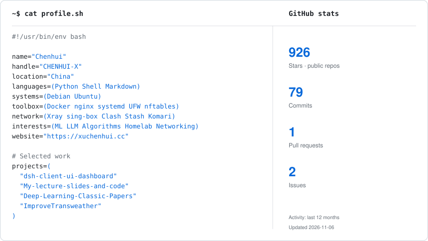
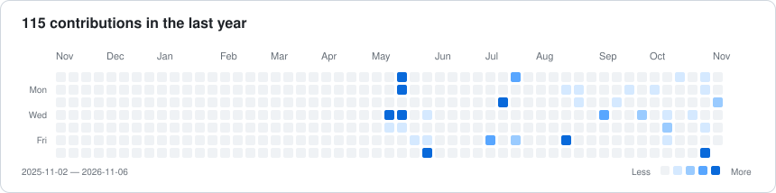
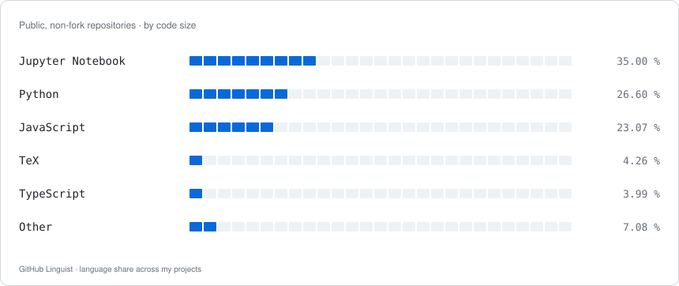

<h1 align="center">Chenhui</h1>

<p align="center"><samp>LLM / Algorithms / Linux / Homelab</samp></p>

<p align="center">
  <a href="https://xuchenhui.cc">Website</a> ·
  <a href="https://space.bilibili.com/294132471">Bilibili</a> ·
  <a href="https://github.com/CHENHUI-X?tab=repositories">Repositories</a>
</p>

<p align="center">
  <picture>
    <source media="(max-width: 900px)" srcset="./assets/overview-mobile.svg">
    
  </picture>
</p>

<p align="center">
  <a href="https://github.com/CHENHUI-X/dsh-client-ui-dashboard" title="DeepSeek Harness 实时指标面板">Harness Dashboard</a> ·
  <a href="https://github.com/CHENHUI-X/My-lecture-slides-and-code" title="B站课程 PPT 与配套代码">Lecture Slides &amp; Code</a> ·
  <a href="https://github.com/CHENHUI-X/Deep-Learning-Classic-Papers" title="深度学习经典论文与笔记">Deep Learning Papers</a> ·
  <a href="https://github.com/CHENHUI-X/ImproveTransweather" title="硕士毕业项目">Transweather</a>
</p>

<details>
<summary>View profile.sh</summary>

```bash
#!/usr/bin/env bash

name="Chenhui"
handle="CHENHUI-X"
location="China"
languages=(Python Shell Markdown)
systems=(Debian Ubuntu)
toolbox=(Docker nginx systemd
         UFW nftables)
network=(Xray sing-box Clash
         Stash Komari)
interests=(ML LLM Algorithms
           Homelab Networking)
website="https://xuchenhui.cc"

# Selected work
projects=(
  "dsh-client-ui-dashboard"
  "My-lecture-slides-and-code"
  "Deep-Learning-Classic-Papers"
  "ImproveTransweather"
)
```

</details>

<br>

<h3 align="center">Contributions</h3>

<p align="center">
  <picture>
    <source media="(max-width: 900px)" srcset="./assets/contributions-mobile.svg">
    
  </picture>
</p>

<br>

<h3 align="center">Code languages</h3>

<p align="center">
  <picture>
    <source media="(max-width: 900px)" srcset="./assets/languages-mobile.svg">
    
  </picture>
</p>
