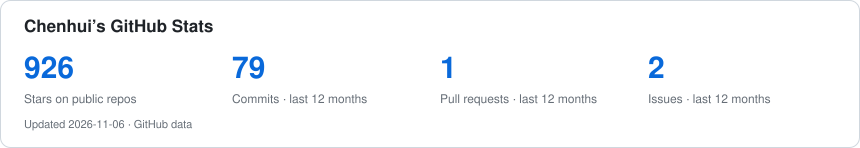

# Chenhui

<samp>LLM / Algorithms / Linux / Homelab</samp>

### ~$ cat profile.sh

```bash
#!/usr/bin/env bash

name="Chenhui"
handle="CHENHUI-X"
location="China"
languages=(Python Shell Markdown)
systems=(Debian Ubuntu)
toolbox=(Docker nginx systemd
         UFW nftables)
network=(Xray sing-box Clash
         Stash Komari)
interests=(ML LLM Algorithms
           Homelab Networking)
website="https://xuchenhui.cc"
```

[Website](https://xuchenhui.cc) · [Bilibili](https://space.bilibili.com/294132471) · [Repositories](https://github.com/CHENHUI-X?tab=repositories)

### Selected work

- **[dsh-client-ui-dashboard](https://github.com/CHENHUI-X/dsh-client-ui-dashboard)** — DeepSeek Harness 实时指标面板
- **[My-lecture-slides-and-code](https://github.com/CHENHUI-X/My-lecture-slides-and-code)** — B站课程 PPT 与配套代码
- **[Deep-Learning-Classic-Papers](https://github.com/CHENHUI-X/Deep-Learning-Classic-Papers)** — 深度学习经典论文与笔记
- **[ImproveTransweather](https://github.com/CHENHUI-X/ImproveTransweather)** — 硕士毕业项目

### Activity

<picture>
  <source media="(max-width: 600px)" srcset="./assets/stats.svg">
  
</picture>

<br>
<br>

<picture>
  <source media="(max-width: 600px)" srcset="./assets/contributions-mobile.svg">
  
</picture>
